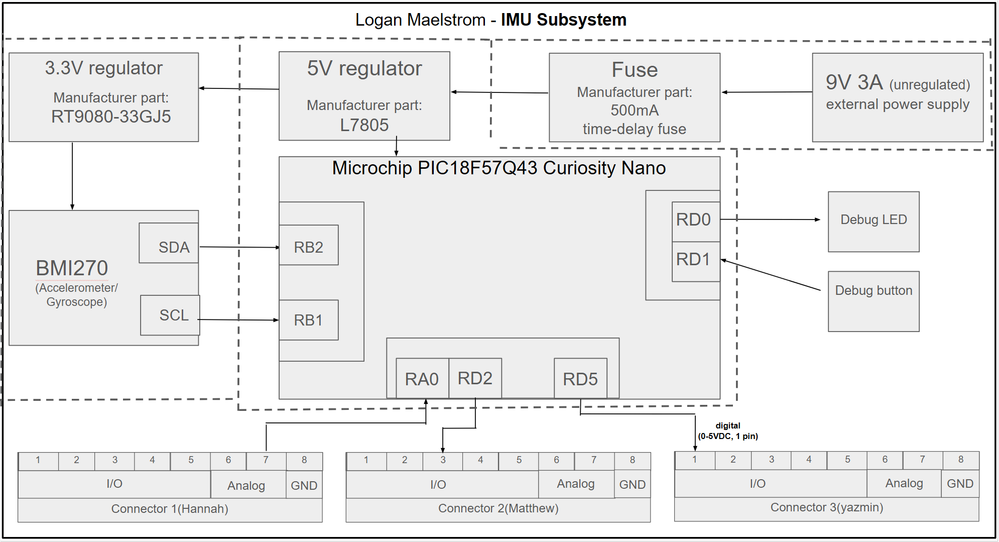

## Overview
The purpose of this block diagram is to provide a clear overview of the system’s electrical connections and how the major components interact. The system is powered by a 9 V unregulated source, which is stepped down through 5 V and 3.3 V regulators to provide the required power levels for the different components. A PIC18F57Q43 microcontroller serves as the main controller, receiving sensor data from the BMI270 through SDA and SCL communication lines. The BMI270 is an accelerometer and gyro sensor, serving as a useful component that can sense head movements related to drowsiness while driving. The microcontroller also interfaces with components such as the debug LED and button, as well as three team connectors that provide digital and analog signals. Overall, the diagram helps show the system’s power distribution, sensor connections, control signals, and interfaces between different parts of the project.

## Block Diagram

Individual Block Diagram - Logan Maelstrom

