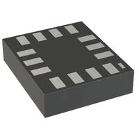
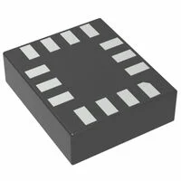
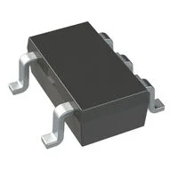

**6-Axis Inertial Measurement Unit (IMU)**

1. BMI323 surface mount accelerometer/gyroscope (6 axis)

    

    * $3.91/each
    * [link to product](https://www.digikey.com/en/products/detail/bosch-sensortec/BMI323/16719593)

    | Pros                                      | Cons                                                             |
    | ----------------------------------------- | ---------------------------------------------------------------- |
    | Low power consumption                     | Tiny 14-pin LGA package                                          |
    | Compatible with 3.3V rail                 | More features than our project application may require           |
    | Supports I²C                              | Requires software/configuration work                             |
    | Small package                             | No integrated magnetometer                                       |
    | Built-in motion/orientation detection     |
    | Wide programmable measurement ranges      |

2. BMI270 surface mount accelerometer/gyroscope (6 axis)

    

    * $4.23/each
    * [Link to product](https://www.digikey.com/en/products/detail/bosch-sensortec/BMI270/9974486)

    | Pros                                                              | Cons                |
    | ----------------------------------------------------------------- | ------------------- |
    | Low power consumption                                             | More expensive than BMI323     |
    | Compatable with 3.3V rail                                         | Tiny 14-pin LGA package is difficult to solder/prototype |
    | Supports I²C communication                                        | Many wearable features aren't useful for the specific Drowsy Driver Alarm project | 
    | Designed specifically for wearable applications                   | Requires software/configuration to work |
    | Small size/footprint (2.5mm x 3.0mm)                              |
    | Built-in motion detection features                                |

3. LSM6DSMTR surface mount accelerometer/gyroscope/temperature (6 axis)

    

    * $4.55/each
    * [Link to product](https://www.digikey.com/en/products/detail/stmicroelectronics/LSM6DSMTR/6192777?s=N4IgTCBcDaIDYGcC2A2AJsgLgJxAXQF8g)
  
    | Pros                                                              | Cons                | 
    | ----------------------------------------------------------------- | ------------------- |
    | Low power consumption                                             | More expensive than both previous examples
    | Compatible with 3.3V rail                                         | Tiny 14-pin LGA package is difficult to solder/prototype |
    | Supports I²C communication                                        | Older-generation IMU design | 
    | Built-in tilt detection and significant motion detection          | No I3C interface    |
    | High mechanical-shock robustness                                  | OIS/EIS features are unnecessary for our Drowsy Driver Alarm project |
    | Dedicated motion interrupts                                       | LGA package is difficult to prototype with |

**Choice:** Option 2: BMI270 surface mount accelerometer/gyroscope (6 axis)

**Rationale:** The BMI270 was manufactured with the purpose of wearable applications, such as recognizing human/head motion, making it a striking candidate from the list. Bosch specifically designed this chip for the same purpose our project is meant to portray. the BMI270 also has on-chip any-motion, no-motion, stationary, significant-motion, and activity-change recognition, which lines up incredibly well with that our project is trying to accomplish. Overall, this is our best candidate for a fair price, and there are plenty of units in stock on DigiKey with quick shipping times.

----

**3.3V Voltage Regulator**

1. AP2112K-3.3TRG1 surface mount 3.3V linear regulator

   

   * $0.28/each
   * [Link to product](https://www.digikey.com/en/products/detail/diodes-incorporated/AP2112K-3-3TRG1/4470746)
  
   | Pros                                                              | Cons                |
   | ----------------------------------------------------------------- | ------------------- |
   | Very inexpensive                                                  | 80µA quiescent current     |
   | High 600mA output capacity                                        | Linear-regulator efficiency loss |
   | Low dropout voltage                                               | Limited to 6V maximum | 
   | Built-in overcurrent protection                                   | Surface-mount package may be more difficult to solder |
   | Built-in overtemperature protection                               | Fixed 3.3V output
   | Enable/shutdown control                                           |
   | High availability                                                 |

2. RT9080-33GJ5 through hole 3.3V linear regulator

   

   * $0.28/each
   * [Link to product](https://www.digikey.com/en/products/detail/richtek-usa-inc/RT9080-33GJ5/6161634)
  
   | Pros                                                              | Cons                |
   | ----------------------------------------------------------------- | ------------------- |
   | Extremely low 4µA quiescent current                               | 5.5V maximum current     |
   | High 600mA output capacity                                        | Higher maximum dropout than AP2112K |
   | 75dB power-supply rejection                                       | Surface-mount package may be more difficult to solder | 
   | Built-in overcurrent protection                                   | Fixed 3.3V output |
   | Built-in overtemperature protection                               | Linear-regulator efficiency loss
   | Enable/shutdown control                                           |
   | High availability                                                 |
   | Very inexpensive
