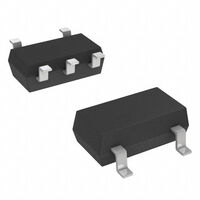
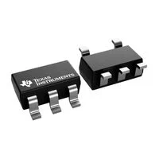
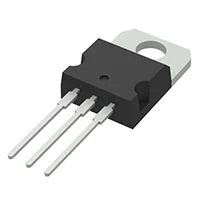
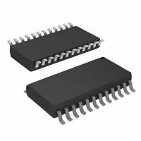
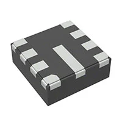
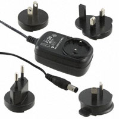
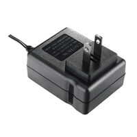
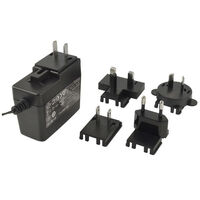

**6-Axis Inertial Measurement Unit (IMU)**

1. BMI323 Surface-Mount Accelerometer/Gyroscope/Temperature (6 axis)

    

    * $3.91/each
    * [link to product](https://www.digikey.com/en/products/detail/bosch-sensortec/BMI323/16719593)

    | Pros                                      | Cons                                                             |
    | ----------------------------------------- | ---------------------------------------------------------------- |
    | Low power consumption                     | Tiny 14-pin LGA package                                          |
    | Compatible with 3.3V rail                 | More features than our project application may require           |
    | Supports I²C                              | Requires software/configuration work                             |
    | Small package                             | No integrated magnetometer                                       |
    | Built-in motion/orientation detection     |
    | Wide programmable measurement ranges      |

2. BMI270 Surface-Mount Accelerometer/Gyroscope/Temperature (6 axis)

    

    * $4.23/each
    * [Link to product](https://www.digikey.com/en/products/detail/bosch-sensortec/BMI270/9974486)

    | Pros                                                              | Cons                |
    | ----------------------------------------------------------------- | ------------------- |
    | Low power consumption                                             | More expensive than BMI323     |
    | Compatable with 3.3V rail                                         | Tiny 14-pin LGA package is difficult to solder/prototype |
    | Supports I²C communication                                        | Many wearable features aren't useful for the specific Drowsy Driver Alarm project | 
    | Designed specifically for wearable applications                   | Requires software/configuration to work |
    | Small size/footprint (2.5mm x 3.0mm)                              |
    | Built-in motion detection features                                |

3. LSM6DSMTR Surface-Mount Accelerometer/Gyroscope/Temperature (6 axis)

    

    * $4.55/each
    * [Link to product](https://www.digikey.com/en/products/detail/stmicroelectronics/LSM6DSMTR/6192777?s=N4IgTCBcDaIDYGcC2A2AJsgLgJxAXQF8g)
  
    | Pros                                                              | Cons                | 
    | ----------------------------------------------------------------- | ------------------- |
    | Low power consumption                                             | More expensive than both previous examples
    | Compatible with 3.3V rail                                         | Tiny 14-pin LGA package is difficult to solder/prototype |
    | Supports I²C communication                                        | Older-generation IMU design | 
    | Built-in tilt detection and significant motion detection          | No I3C interface    |
    | High mechanical-shock robustness                                  | OIS/EIS features are unnecessary for our Drowsy Driver Alarm project |
    | Dedicated motion interrupts                                       | LGA package is difficult to prototype with |

**Choice:** Option 2: BMI270 surface mount accelerometer/gyroscope (6 axis)

**Rationale:** The BMI270 was manufactured with the purpose of wearable applications, such as recognizing human/head motion, making it a striking candidate from the list. Bosch specifically designed this chip for the same purpose our project is meant to portray. the BMI270 also has on-chip any-motion, no-motion, stationary, significant-motion, and activity-change recognition, which lines up incredibly well with that our project is trying to accomplish. Overall, this is our best candidate for a fair price, and there are plenty of units in stock on DigiKey with quick shipping times.

----

**3.3V Voltage Regulator**

1. AP2112K-3.3TRG1 Surface-Mount 3.3V LDO Linear Regulator

   

   * $0.28/each
   * [Link to product](https://www.digikey.com/en/products/detail/diodes-incorporated/AP2112K-3-3TRG1/4470746)
  
   | Pros                                                              | Cons                |
   | ----------------------------------------------------------------- | ------------------- |
   | Very inexpensive                                                  | 80µA quiescent current     |
   | High 600mA output capacity                                        | Linear-regulator efficiency loss |
   | Low dropout voltage                                               | Limited to 6V maximum input voltage | 
   | Built-in overcurrent protection                                   | Surface-mount package may be more difficult to solder |
   | Built-in overtemperature protection                               | Fixed 3.3V output |
   | Enable/shutdown control                                           |
   | High availability                                                 |

2. RT9080-33GJ5 Surface-Mount 3.3V LDO Linear Regulator

   

   * $0.28/each
   * [Link to product](https://www.digikey.com/en/products/detail/richtek-usa-inc/RT9080-33GJ5/6161634)
  
   | Pros                                                              | Cons                |
   | ----------------------------------------------------------------- | ------------------- |
   | Extremely low 4µA quiescent current                               | 5.5V maximum input voltage     |
   | High 600mA output capacity                                        | Higher maximum dropout than AP2112K |
   | 75dB power-supply rejection                                       | Surface-mount package may be more difficult to solder | 
   | Built-in overcurrent protection                                   | Fixed 3.3V output |
   | Built-in overtemperature protection                               | Linear-regulator efficiency loss |
   | Enable/shutdown control                                           |
   | High availability                                                 |
   | Very inexpensive                                                  |

3. TLV75533PDBVR Surface-Mount 3.3V LDO Linear Regulator

   

   * $0.42/each
   * [Link to product](https://www.digikey.com/en/products/detail/texas-instruments/TLV75533PDBVR/9685550)
  
   | Pros                                                              | Cons                |
   | ----------------------------------------------------------------- | ------------------- |
   | Low 31µA quiescent current                                        | Lower 500mA capacity than other candidates     |
   | Low 238mV maximum dropout                                         | Higher quiescent current than RT9080 |
   | Built-in overcurrent protection                                   | 5.5V maximum input | 
   | Built-in overtemperature protection                               | Fixed 3.3V output |
   | Wide -40°C to 125°C operating range                               | Linear-regulator efficiency loss |
   | Compact SOT-23-5 package                                          |
   | High availability                                                 |

**Choice:** Option 2: RT9080-33GJ5 Surface-Mount 3.3V LDO Linear Regulator

**Rationale:** The RT9080-33GJ5 by Richtek has the lowest quiescent current of the candidates, being 4µA. Additionally, it still gives 600mA of maximum output current and is very affordable. Low power consumption is important for the Drowsy Driver Alarm project since the product is intended to be wearable. This LDO also provides exceptional protections built-in, such as overcurrent and overtemperature protection. Although its maximum input voltage is lower than other candidates like the AP2112K, this isn't a signifcant trade-off since the RT9080 can be powered by the system's 5V rail. Overall, this inexpensive LDO is exceptionally capable for our product's needs.

----

**5V Voltage Regulator**

1. L7805ACV-DG Through-Hole 5V Linear Regulator

   

   * $1.21/each
   * [Link to product](https://www.digikey.com/en/products/detail/stmicroelectronics/L7805ACV-DG/3945937)
  
   | Pros                                                              | Cons                |
   | ----------------------------------------------------------------- | ------------------- |
   | High 1.5A output capacity                                         | High 6mA quiescent current     |
   | Easy-to-solder through-hole package                               | Poor efficiency for 9V → 5V conversion |
   | Very simple regulator circuit                                     | Can generate significant heat at higher loads | 
   | Built-in short-circuit protection                                 | Large TO-220 package |
   | Built-in overtemperature protection                               | Approximately 2V dropout at 1A |
   | 35 V maximum input provides large safety margin                   | Fixed 5V output |
   | Good current availability                                         |

2. LM2575MX-5.0/NOPB Surface-Mount 5V Buck (Switching) Regulator

   

   * $3.09/each
   * [Link to product](https://www.digikey.com/en/products/detail/texas-instruments/LM7805MPX-NOPB/366776)
  
   | Pros                                                              | Cons                |
   | ----------------------------------------------------------------- | ------------------- |
   | More efficient than linear regulators                             | Requires external inductor and capacitors     |
   | Wide 4–40 V input range                                           | Large 24-pin SOIC package |
   | High 1 A output capacity                                          | Only 52kHz switching frequency | 
   | Built-in overcurrent protection                                   | More complex PCB design than linear regulator |
   | Enable/shutdown control                                           | Switching can introduce electrical noise |
   | Reduced heat generation vs. linear regulator                      | More expensive than L7805ACV-DG |
   | Fixed 5V output simplifies configuration                          | Lower output capacity than LMR43620R5RPER |

3. LMR43620R5RPER Surface-Mount 5V Buck (Switching) Regulator

   

   * $2.27/each
   * [Link to product](https://www.digikey.com/en/products/detail/texas-instruments/LMR43620R5RPER/20414090?s=N4IgTCBcDaIDIFkBKAWAzANjABiQViQAUBRJEAXQF8g)
  
   | Pros                                                              | Cons                |
   | ----------------------------------------------------------------- | ------------------- |
   | High 2A output capacity                                           | Much more expensive     |
   | High efficiency compared with linear regulators                   | Requires external inductor and capacitors |
   | Extremely low 1.3µA quiescent current                             | More complex PCB layout | 
   | Wide 3–36V input range                                            | Tiny VQFN package is more difficult to hand solder |
   | Reduced heat generation                                           | Switching regulator can introduce electrical noise |
   | Compact 2mm × 2mm package                                         | More complex than necessary for light loads |
   | Built-in overcurrent protection                                   |
   | Wide −40°C to 150°C operating range                               |

**Choice:** Option 3: LMR43620R5RPER Surface-Mount 5V Buck (Switching) Regulator

**Rationale:** The LMR43620R5RPER by Texas Instruments is selected because its high efficiency and low power consumption make it the best candidate for our Drowsy Driver Alarm. Unlike the L7805ACV-DG linear regulator, the LMR43620 uses a buck switching design, allowing a 9V input to be stepped down to 5V with significantly less energy being wasted as heat. This is especially beneficial for our wearable design, where excessive heat and unnecessary power consumption should be minimized. The LMR43620 also provides up to 2A of output current, giving our circuit plenty of current capacity, while its small 2mm × 2mm package minimizes PCB space. Although it is more expensive and requires additional external components, its efficiency, low 1.3µA quiescent current, compact size, and reduced heat generation make these tradeoffs worthwhile for our application.

----

**9V External Power Source**

1. Microchip AC002014 - 9V External Power Supply, 800mA

   

   * $25.49/each
   * [Link to product](https://www.digikey.com/en/products/detail/microchip-technology/AC002014/2480293)
   
   | Pros                                                              | Cons                |
   | ----------------------------------------------------------------- | ------------------- |
   | Provides required 9V output                                       | Most expensive (per amp) of the three power-supply candidates     |
   | Sufficient 800mA output capacity                                  | Limited to 800mA maximum output |
   | International 110–220 VAC input                                   | Lower 7.2W capacity | 
   | Interchangeable AC plug blades                                    | 2.5mm ID plug requires matching barrel jack |
   | Standard center-positive barrel connector                         | Less current headroom for future additions |
   | Commercial Class II wall supply                                   | 
   | Currently in stock                                                |

2. UNIIVE UV313-0913 9V External Power Supply

   

   * $17.40/each
   * [Link to product](https://www.digikey.com/en/products/detail/unifive-global-limited/UV313-0913/26420296)
  
   | Pros                                                              | Cons                |
   | ----------------------------------------------------------------- | ------------------- |
   | Lowest price of the three candidates                              | Lower output capacity than 2.2A Bel Power Solutions candidate     |
   | Higher 1.3A output capacity                                       | Fixed US-style AC plug |
   | Universal 100–240 VAC input                                       | No interchangeable AC plug blades | 
   | 82.96% efficiency                                                 | 2.1mm ID requires matching barrel jack |
   | Low 100mW no-load consumption                                     | Limited 0–40°C operating range |
   | Safety approvals: CB, CE, cULus, FCC                              | 
   | Long 1.5m output cable                                            |
   | Currently in stock                                                |

3. Bel Power Solutions SMI18-9-V-P6R

   

   * $30.27/each
   * [Link to product](https://www.digikey.com/en/products/detail/bel-power-solutions/SMI18-9-V-P6R/5417776)
  
   | Pros                                                              | Cons                |
   | ----------------------------------------------------------------- | ------------------- |
   | Highest 2.2A output capacity                                      | Highest overall purchase price of all candidates     |
   | High 20W output power                                             | More power capacity than project likely requires |
   | Universal 90–264 VAC input                                        | Larger/heavier power adapter | 
   | Interchangeable AC plug blades                                    | 2.5mm ID requires matching barrel jack |
   | Level VI energy efficiency                                        | Limited 0–40°C operating range |
   | Low 100mW no-load consumption                                     | Right-angle barrel plug may constrain enclosure layout |
   | Long 1.5m output cable                                            |
   | Extensive international safety approvals                          |

**Choice:** Option 2: UNIIVE UV313-0913 9V External Power Supply

**Rationale:** The UV313-0913 was selected because it provides the best balance of output capacity, price, efficiency, and availability for our Drowsy Driver Alarm project. Its 1.3A output provides more current headroom than the 800mA Microchip supply while costing significantly less. Although the Bel Power Solutions supply can provide 2.2A, that additional capacity is likely unnecessary for our system and comes at a considerably higher price. The UV313-0913 also supports universal 100–240 VAC input, has multiple safety certifications, and has low no-load power consumption. Overall, it provides sufficient power for the system without paying for unnecessary excess capacity.
