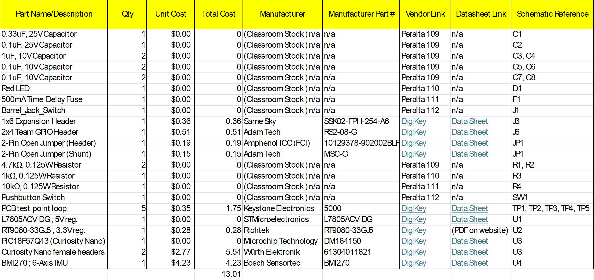

## Overview
The Bill of Materials (BOM) documents the components required to construct the IMU subsystem. It includes the major integrated circuits, voltage regulators, passive components, connectors, debugging hardware, and other supporting components shown in the schematic. Component quantities, costs, manufacturers, part numbers, vendor information, datasheets, and schematic reference designators are included where applicable to support purchasing, assembly, and future development of the subsystem.
> [!NOTE]
> To access the vendor and datasheet links for the listed components, please download and view the BOM Excel (.xlsx) file.

## Bill of Materials
{style width: "2000"}
**Figure 1:** IMU Subsystem - Bill of Materials

## Resources
The completed Bill of Materials is available in the following formats:

- [View or download the IMU Subsystem BOM PDF](SubsystemDesignBOM.pdf)
- [Download the editable IMU Subsystem BOM Excel file](SubsystemDesignBOM.xlsx)
