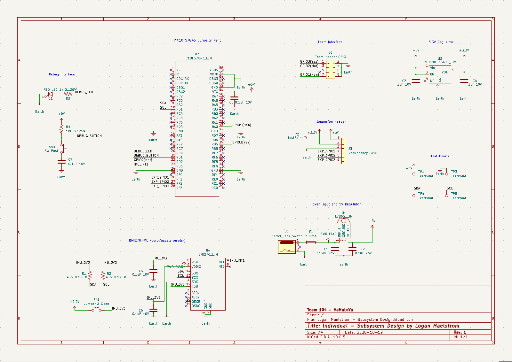

## Overview

This schematic is designed to utilize the embedded 6-axis IMU to detect head movements (rotation and acceleration) and send signals to the Curiosity Nano for the microcontroller to discern if the drowsy driver alarm should be deployed or not. The system contains voltage regulators to step down 9V to 5V to power the Curiosity Nano, and 5V to 3.3V to power the IMU.

> [!NOTE]
> The schematic image should be displayed below. If it's not shown, the schematic PDF can be downloaded and opened at the bottom of this page.

**Figure 1:** Subsystem Design Schematic for IMU.

## Resouces

The schematic as a PDF download is available [*here*](IMU_SchematicFINAL.pdf), and the Zip folder of the project [*here*](Logan_Maelstrom_Subsystem_Design_SCHEMATIC.zip).
