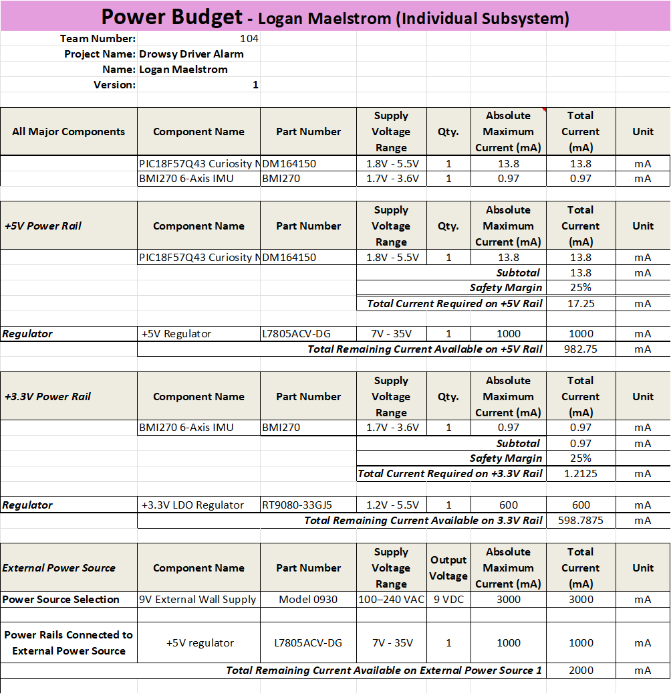

## Overview

This power budget was created to verify that the selected power source and voltage regulators can provide sufficient power for the IMU subsystem. The PIC18F57Q43 Curiosity Nano operates from the 5V rail, while the BMI270 IMU operates from the 3.3V rail. Maximum current requirements were evaluated with a 25% safety margin to ensure that the selected regulators and 9V external power supply provide adequate capacity for the subsystem.

{style width:"350" height:"300;"}

## Conclusions

The completed power budget confirms that the selected power system provides sufficient current for the IMU subsystem. The L7805ACV-DG and RT9080-33GJ5 provide adequate capacity for the 5V and 3.3V rails respectively, including the required 25% safety margin. The classroom-provided 9V 3A external power supply also provides sufficient capacity for the subsystem, confirming that the selected power components meet the design requirements.

## Resouces

The power budget as a PDF download is available [*here*](IMU_PowerBudget_LoganMaelstrom.pdf), and a Microsoft Excel Sheet [*here*](IMU_PowerBudget_LoganMaelstrom.xlsx).
