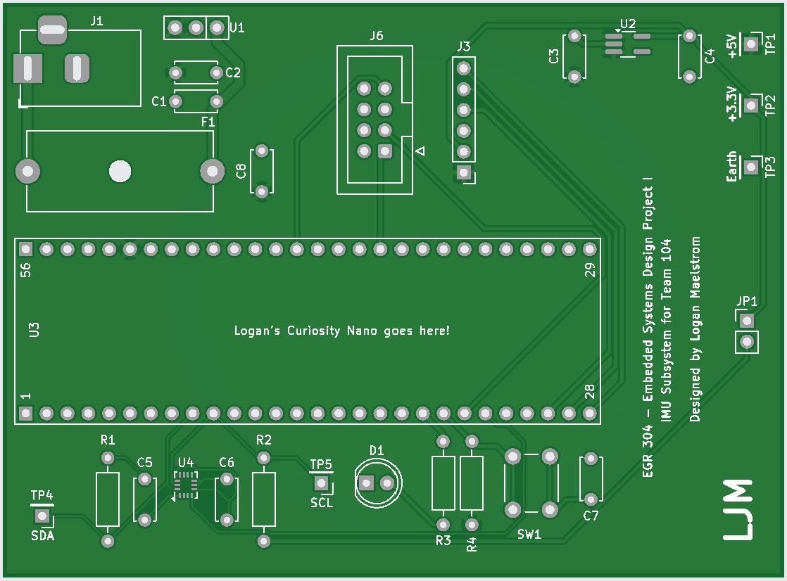
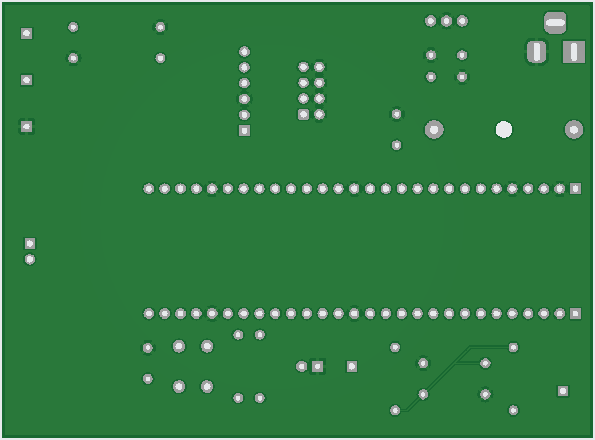

## Overview

This PCB implements my individual subsystem for the Team 104 Drowsy Driver Alarm. The design interfaces a PIC18F57Q43 Curiosity Nano with a BMI270 6-axis inertial measurement unit (IMU). The board includes 9V input power regulation to 5V and 3.3V, team and expansion GPIO interfaces, debugging hardware, test points, and supporting circuitry. The PCB is being designed as a two-layer board in KiCad for fabrication using JLCPCB's outsourced manufacturing process.

## PCB Layout

| Front | Back |
| ---------------- | ----------------- |
|  |  |

## Design Files

### PCB Layout PDFs

- [Front PCB Layout PDF](IMU_Subsystem_PCB_Front.pdf)
- [Back PCB Layout PDF](IMU_Subsystem_PCB_Back.pdf)

### ECAD Project Files

- [Complete KiCad Project ZIP](Logan%20Maelstrom%20-%20Subsystem%20Design.zip)

### Manufacturing Files

- [Gerber and Drill Files ZIP](IMU_Subsystem_Gerbers_and_Drill.zip)
